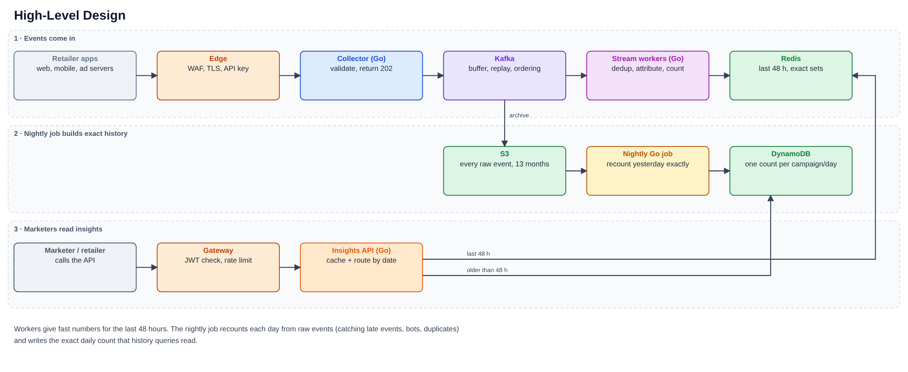
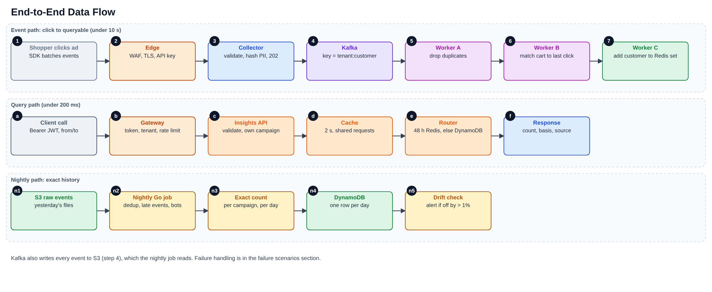
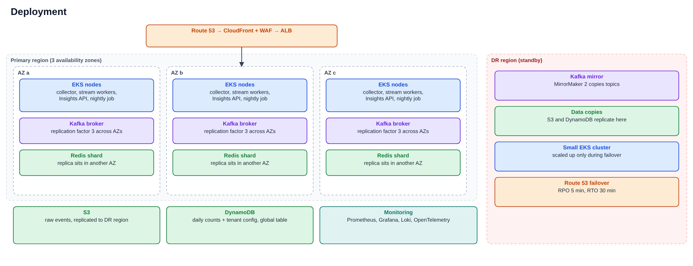

# 1. Requirements

## 1.1 Functional requirements

1. Collect events from retailer websites and apps: product views, add-to-cart, ad impressions and ad clicks.
2. Give marketers and retailers per-campaign insights through APIs: how many customers saw the ad, clicked it, and added a product to the cart after clicking.
3. Answer both recent (real-time) and historical queries for a time range.
4. Link an add-to-cart to the ad click that led to it (last click, within 30 minutes).
5. Support many retailers on one platform. Each retailer has its own configuration (quotas, retention, attribution window), and its data is isolated from every other retailer.

## 1.2 Non-functional requirements

1. Throughput: 100K events/s on average, 300K/s at normal peak, 1M/s during sale events.
2. Availability: 99.95% for ingestion with no accepted event lost, 99.9% for the API.
3. API latency: p99 under 200 ms.
4. Freshness: an event shows up in insights within 10 seconds.
5. Accuracy: recent numbers are exact; history is exact per day and checked daily against raw data.
6. Retention: recent data 48 hours, daily results 3 years, raw events 13 months.
7. Isolation: one retailer can neither read another's data nor slow it down.
8. Recovery: lose at most 5 minutes of data and be back in 30 minutes after a region failure.
9. Security: encryption in transit and at rest, PII hashed, audit trail.

## 1.3 Assumptions

* Traffic can be uneven (a few big retailers, many small ones) or even. The system has to handle both.
* Only some events feed insights: impressions, clicks and add-to-cart. We assume they are about 20% of all events. This is an estimate, not a requirement. The reasoning, and what changes if it is wrong, is in the separate *Assumptions and Sizing* document.
* 20 retailers at launch, 100 or more within two years.
* About 200K active campaigns, with 3 metrics each.
* Events are about 500 bytes. SDKs send them in batches of about 50.
* Every event has an `event_id` and an event time. Client clocks can be wrong.
* The customer ID is a stable pseudonymous ID from the retailer.
* We run on AWS. The team knows Go, Kafka, Redis and DynamoDB.

## 1.4 Out of scope

Bidding, campaign creation UI, billing, multi-touch attribution.

# 2. High-level design

{width=88%}

Events enter through the edge and a collector, land in Kafka, and stream workers count them into Redis. Marketers call the Insights API, which reads Redis for the last 48 hours and DynamoDB for anything older.

**Why S3?** Kafka keeps events for 7 days and Redis for 48 hours. S3 keeps every event for 13 months, which gives us three things we cannot get elsewhere: the nightly job can recount any past day, we can replay events after a bug fix, and we can settle disputes about a number.

**Why a nightly job when workers already count?** Workers need to be fast, so they work on events as they arrive. That means they can miss events that arrive late, duplicates that slip past the dedup window, and bot traffic found later. The nightly job reads the whole previous day from S3 and recounts it properly. Its result becomes the daily history in DynamoDB, and we compare it with the worker numbers to catch bugs.

# 3. Design details

## 3.1 Ingestion

* The collector validates the event, hashes PII, adds the tenant (from the API key) and a server timestamp, and writes to Kafka with `acks=all`. It returns `202`. Bad events go to a dead-letter topic. If Kafka is down, events wait in a small disk buffer and are sent when it recovers.
* **Event schema (Protobuf or Avro):** `event_id`, `tenant_id`, `type` (impression, click, add_to_cart, product_view), `campaign_id` (ads only), `customer_id`, `event_ts`, `server_ts`.
* **Topics:** `events.ads` (impressions, clicks, add-to-cart; key `tenant:customerId`), `events.other` (product views; archive only), `events.late`, `events.dlq`. The key keeps one customer's events in order on one partition, which attribution depends on.

## 3.2 Stream workers (Go, one consumer group per worker type)

| Worker | What it does | State |
|---|---|---|
| A: dedup | `SET NX event_id` with a 1-hour expiry. If the key exists, drop the event. | Redis (state cluster) |
| B: attribution | On a click, remember `{campaign, time}` for that customer for 30 minutes. On an add-to-cart, if a click is remembered, count a `clickToBasket` for that campaign. | Redis (state cluster) |
| C: counting | Group customers by tenant, campaign, metric and 5-minute event-time bucket. Every 5 seconds, `SADD` them to Redis. Events up to 5 minutes late still update their bucket. Older ones go to `events.late` for the nightly job. | Memory, then Redis |

Workers commit their Kafka offset only after the writes succeed. `SET NX` and `SADD` are safe to repeat, so a crash and replay cannot double count.

## 3.3 Storage

| Store | Holds | Kept |
|---|---|---|
| Redis (hot) | One set of customer IDs per tenant, campaign, metric and 5-minute bucket | 48 hours |
| Redis (state) | Dedup keys, last click per customer | 1 hour / 30 minutes |
| DynamoDB | One row per campaign, metric and day with the exact unique count; tenant configuration and campaign ownership | 3 years |
| S3 (Parquet) | Raw events, partitioned by tenant and date | Ad events 13 months, other events 30 days |

A recent query unions the 5-minute sets in its range and counts the members, so a customer who appears in several buckets is counted once. A historical query reads one DynamoDB row per day. For a single day the number is exact. For several days we add the daily counts, so a customer active on two days counts twice. The API says which one you got in the `basis` field.

```{=openxml}
<w:p><w:r><w:br w:type="page"/></w:r></w:p>
```

## 3.4 Insights API

```
GET /v1/ad/{campaignID}/clicks
GET /v1/ad/{campaignID}/impressions
GET /v1/ad/{campaignID}/clickToBasket
    ?from=<RFC3339>&to=<RFC3339>        (default: last 24 hours)
```

Response fields: `campaignId`, `metric`, `count`, `basis`, `from`, `to`, `source`, `degraded`, `asOf`.

* `source` is `realtime` (Redis) or `historical` (DynamoDB). `basis` is `unique_customers` or `sum_of_daily_unique`. `degraded` is true when Redis failed and we answered from history.
* A range starting within 48 hours goes to Redis, anything older to DynamoDB. Maximum range is 90 days.
* Auth is a JWT. The tenant comes only from the token. A campaign owned by another tenant returns `404`.
* Results are cached for 2 seconds, and identical requests arriving together share one lookup.

# 4. End-to-end data flow

{width=88%}

# 5. Technology choices

| Layer | Choice | Why |
|---|---|---|
| Collector, workers, API | Go on EKS | Fast, small, and the team knows it |
| Event backbone | Kafka (MSK) | Absorbs bursts, keeps order per key, can replay |
| Hot store and state | Redis Cluster | Sub-millisecond, exact sets, built-in expiry |
| Daily results, config | DynamoDB | Simple key lookups, scales on demand, global tables for DR |
| Raw events | S3 with Parquet | Cheap and replayable |
| Nightly job | Go job on a Kubernetes CronJob | Same language, nothing new to run |
| Monitoring | Prometheus, Grafana, Loki, OpenTelemetry | Open standards |
| Delivery | Terraform, GitHub Actions, ArgoCD | Repeatable, reviewable |

If worker logic outgrows plain Go consumers (joins, multi-touch attribution), the same topics can feed Flink or Kafka Streams.

# 6. Deployment

{width=88%}

* Everything runs in three availability zones. Losing one zone leaves two-thirds of capacity, and we size for that.
* The standby region holds a Kafka mirror and copies of S3 and DynamoDB. Its EKS cluster is small until a failover.
* Releases go out as a canary (5%, 25%, 100%) and roll back on their own if errors or latency rise.

# 7. Cross-cutting concerns

**Security.** The edge has a WAF and TLS 1.2 or later. Each retailer has an API key for ingestion and uses JWTs for the API. Services talk over mTLS inside private subnets with default-deny network policies. Data is encrypted in transit and at rest, with a separate KMS key per tenant for S3 and DynamoDB. Customer IDs are hashed at the collector. For a deletion request we erase the ID mapping, and raw files expire on their own. Container images are scanned and run as non-root. CloudTrail and API logs give the audit trail.

**Multi-tenancy.** All tenants share the platform. The tenant ID is part of every event, Kafka key, Redis key, DynamoDB key, cache key and log line. DynamoDB access is limited to a tenant's own keys through IAM conditions. Per-tenant settings (quotas, retention, attribution window) live in DynamoDB and are cached briefly. API and ingest quotas stop one tenant from slowing the others, and return `429` when exceeded. A large or regulated tenant can be moved to its own topics, workers and Redis.

**Observability.** Metrics go to Prometheus and Grafana, logs (JSON, with request ID and tenant) to Loki, traces through OpenTelemetry. The request ID ties them together. A test event is sent every minute to measure real freshness. Alerts are in section 10.

**Scalability.** Collectors and the API scale on request rate. Workers scale on Kafka lag, up to the partition count. Kafka has three times the partitions we need, Redis grows by adding shards, and DynamoDB runs on demand. Details are in section 9.

**Resilience.** Three zones, Kafka with three copies of every partition, a disk buffer in the collector, offsets committed after writes, and writes that are safe to repeat. The API uses timeouts, a circuit breaker and a fallback to DynamoDB. A standby region covers a full outage. Failure cases are in section 8.

**Cost.** We track cost per million events and per tenant, and review it monthly. The big savings are the short 48-hour hot window, workers reading only ad events, S3 lifecycle rules, and Spot instances for the nightly job only. We cap metric labels so monitoring cost stays predictable.

# 8. Failure scenarios

| What goes wrong | How we notice | What we do |
|---|---|---|
| Collector pod, node or a whole zone dies | Pod restarts, 5xx rate | Stateless pods across 3 zones, autoscaling; SDKs retry |
| Kafka broker dies | Under-replicated partitions | Three copies of each partition; another broker takes over |
| Kafka is unreachable | Produce errors | Collector disk buffer, SDK retry, page on-call |
| Bad or poison event | Dead-letter rate | Validate at the edge, send to `events.dlq`, replay after a fix |
| Schema change breaks consumers | Parse errors in CI or DLQ | Compatible schemas only; contract tests |
| Worker crashes or group rebalances | Consumer lag | Offset commits follow writes, so replay is safe |
| Lag keeps growing | Lag and freshness alerts | Autoscale workers; shed non-critical work |
| Redis hot shard fails | Redis errors, breaker opens | Replica takes over; API answers from DynamoDB with `degraded=true`; rebuild from Kafka |
| Redis state cluster lost | Dedup rate drops | Counts stay correct (sets ignore repeats); a few attributions are missed and fixed by the nightly job |
| Redis memory fills up | Memory above 75% | Add shards, shorten the hot window, per-tenant caps |
| DynamoDB throttles | Throttle metric | On-demand capacity, retries with backoff, caching |
| S3 write fails | Connector lag | Kafka still holds 7 days; fix and reprocess |
| Nightly job fails or runs late | Job alert | Safe to rerun per day; recent data unaffected |
| Bad release | Canary error rate | Automatic rollback, feature flags |
| One tenant floods the system | Per-tenant rate, 429s | Quotas; move the tenant to its own resources |
| Wrong client clocks | Skew metric | Clamp to server time within a tolerance |
| Duplicate or bot spike | Dedup and bot rates | Dedup by `event_id`, bot rules, nightly restatement |
| Attribution bug | Drift against nightly job | Replay from S3 into shadow results, compare, switch |
| Whole region down | Route 53 health checks | Fail over to the standby region (5 min of data at risk, 30 min to recover); rehearsed quarterly |

# 9. Scaling, bursts and growth

**Sale events (bursts).**

* Before: load test at twice the expected peak a week ahead, freeze changes two days ahead, and scale collectors, workers, API and Redis up 30 minutes early.
* During: Kafka absorbs the spike while workers catch up. The API cache and shared lookups protect Redis. One dashboard shows ingest rate, lag, freshness, Redis memory and API latency.
* If overloaded, shed in this order: debug sampling, then lower-priority tenants' non-billing events, then slower dashboard refresh. Never drop clicks or impressions.
* After: scale down gradually and review what saturated.

**Organic growth.** We review capacity monthly and act on these signals.

| Signal | Action |
|---|---|
| Any tier above 60% at peak | Add capacity to keep 40% headroom |
| Redis memory above 70% | Add shards or shorten the hot window |
| One tenant above 20% of traffic | Move it to its own topics, workers and Redis |
| Nightly job takes more than 4 hours | Split the work by tenant or campaign range |
| Redis cost becomes the main bill | Look at approximate counting for the hot tier |
| Worker logic gets too complex | Move the same topics to Flink or Kafka Streams |

New retailers follow a checklist: quotas, schema check, load test at twice their forecast, dashboards. Sizing numbers are in *Assumptions and Sizing*.

# 10. Metrics and alerts

| Area | What we watch | Alert when |
|---|---|---|
| Ingestion | Requests/s, success rate, p99, 4xx/5xx, disk buffer size | Success below 99.9% for 5 minutes |
| Kafka | Consumer lag, under-replicated partitions, disk, produce latency | Lag over 30 s |
| Workers | Processing time, rebalances, commit failures, DLQ and late-event rates | DLQ spike, repeated rebalances |
| Freshness | Time for a test event to become queryable | p99 over 30 s |
| Redis | Memory, latency, evictions, replication lag | Memory over 75%, p99 over 5 ms |
| DynamoDB | Throttles, latency, errors | Any sustained throttling |
| API | Requests/s, p50 and p99, errors per route, 429s per tenant, cache hit rate, breaker state, `degraded` rate | p99 over 200 ms, error-budget burn |
| Nightly job | Success, duration, drift against workers | Failed or late (page); drift over 1% (ticket) |
| Data quality | Duplicate, bot and attribution rates; unknown tenants; clock skew | Sudden change from baseline (ticket) |
| Security | Auth failures, WAF blocks, cross-tenant attempts | Spike |
| Cost | Cost per million events and per tenant | Up more than 10% week over week (ticket) |

SLOs: ingestion 99.95%, API 99.9%, API p99 under 200 ms, freshness p99 under 10 seconds. We alert on how fast the error budget is burning, not on single spikes. Every page links to a runbook.

# 11. Trade-offs

| Decision | What we gain | What we give up |
|---|---|---|
| Exact sets in Redis | Exact numbers, simple to run | Memory grows with audience size; capped by the 48-hour window and per-tenant limits |
| One row per day in history | Cheap, exact per day | A multi-day total adds daily counts, so repeat customers count once per day (flagged by `basis`). Fix later with nightly 7-day and 30-day counts |
| Go workers instead of Flink | Simple, one language, team knows it | We handle late data and rebalancing ourselves; one Redis call per event |
| Fast numbers now, exact numbers tomorrow | Real-time insights | Late events and bots are missed until the nightly job |
| Shared platform for all tenants | Low cost | Noisy neighbours; covered by quotas and the option to isolate |
| 5-minute buckets | Few keys, cheap range queries | Range edges snap to 5 minutes |
| Last-click attribution | Easy to explain | Ignores earlier touches |

# 12. Delivery plan and risks

| Phase | Weeks | Scope | Done when |
|---|---|---|---|
| 0. Foundations | 1-2 | Repos, CI/CD, Terraform, Kafka/Redis/EKS skeleton, schemas, SLOs | Test service deploys through CI |
| 1. MVP | 3-6 | Collector, Kafka, workers A and C, Redis, clicks and impressions API, one retailer | Freshness under 10 s in staging |
| 2. Core | 7-10 | Attribution, multi-tenancy, quotas, S3, nightly job, DynamoDB history | Drift under 1% |
| 3. Hardening | 11-13 | Load test at 2x peak, failure drills, DR, runbooks, alerts, security review | Burst test and failover pass |
| 4. Launch | 14+ | Onboard retailers gradually, tune capacity and cost | SLOs met for 4 weeks |

Team of about seven: two on ingestion and Kafka, two on stream workers, two on the API, one on platform and reliability. One shared on-call rotation, error budgets, and a weekly operations review.

Top risks: Redis memory above forecast (load test with real audience sizes, caps, short hot window); hot partitions from big retailers (key salting, own resources); a burst bigger than planned (2x load test, pre-scaling, shedding plan); disputes about attribution (clear definition, nightly check, replay tooling); scope creep in metrics (versioned API, backlog gate).

# 13. Extensions and code

**Extensions:** more metrics (CTR, cost per click) by extending Worker C; multi-touch attribution; exact 7-day and 30-day windows computed nightly; live dashboards through SSE or WebSocket; regional cells for data residency; ad-hoc analytics by querying the S3 files.

**Code.** The repo implements the Insights API in Go (standard library only). In-memory stores stand in for Redis and DynamoDB behind the same interface, and a small aggregator models the worker logic.

| Concern | Where |
|---|---|
| Layers | `domain`, `service`, `httpapi`; storage behind interfaces in `store` |
| Real-time vs historical routing | `service.Insights` (response has `source` and `basis`) |
| Auth and tenant checks | `auth`, `middleware.Authenticate` |
| Per-tenant rate limit | `middleware.RateLimit`, `configs/tenants.json` |
| Resilience | `resilience.Breaker`, fallback to history, timeouts, graceful shutdown |
| Cache | `cache.TTL` (expiry and shared lookups) |
| Observability | `metrics`, JSON logs, request ID, `/metrics`, `/healthz`, `/readyz` |

Simplifications: in-memory stores, HS256 tokens instead of signing-key rotation, per-pod rate limit, hand-written metrics format, tracing described but not wired.
